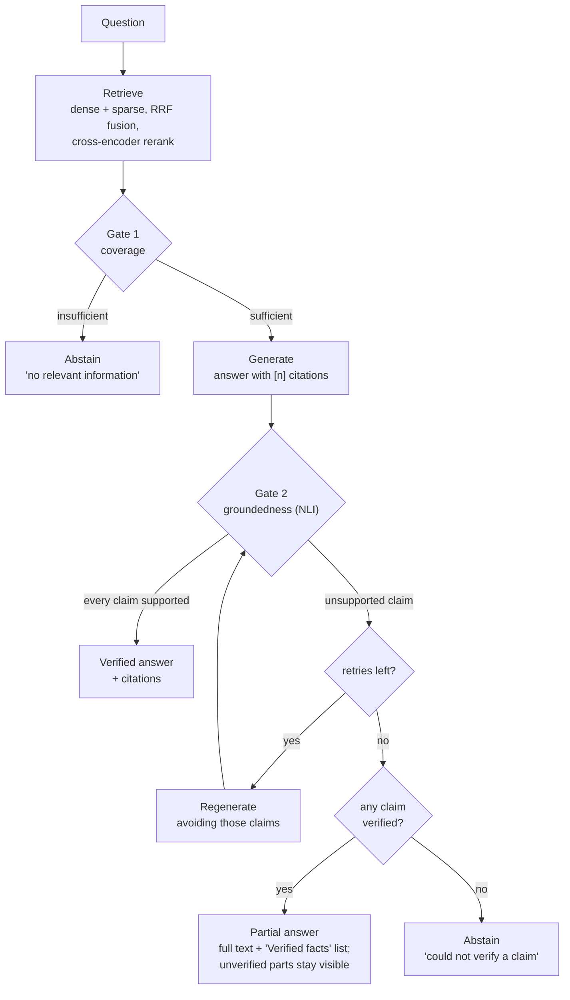

# VeriRAG

A self-verifying document question-answering system. Ask a question about your
own documents and VeriRAG answers it with inline citations — or tells you it
cannot. Its distinguishing feature is a **two-gate verification critic** that
checks coverage *before* generating and groundedness *after*, and withholds any
answer whose claims it cannot trace back to the sources. The design goal is
**faithfulness over fluency**: a confident, well-written, unsupported answer is
treated as the worst possible output, and an honest "the sources do not cover
this" as a correct one.

## How a query flows



When the retries are spent, an answer with **at least one** verified claim is
returned as a *partial* answer rather than withheld: the generator's text is
shown unchanged, followed by a **Verified facts** list of exactly the claims
that passed (each with its source and page). A statement in the answer that is
not in that list was not verified, and the answer says so. With **no** verified
claim there is nothing to stand behind, and the query abstains as before.

Gate 1 reads the cross-encoder's absolute relevance score, short-circuiting
cheaply at either extreme and escalating only a borderline band to an LLM
judge. Gate 2 decomposes the answer into atomic claims and checks each against
the chunks it cites, using a **local NLI encoder (DeBERTa)** — a different model
family from the DeepSeek LLM that wrote the answer, so the verifier cannot
share the generator's failure modes. The self-correction loop is bounded, and
both loops respect a per-query call budget, so the terminal state is always a
verified answer or an explicit abstention.

## Results

Evaluated on **6 PDFs of real academic papers**
(5 distinct papers — one appears as both its camera-ready and arXiv versions,
which the system detects as a near-duplicate) covering graph neural networks,
retrieval-augmented generation and LLM distillation. The question set is
59 questions, stratified, with **ground truth hand-written from the
papers before anything was run**.

| metric | value |
|---|---|
| Questions | 59 (47 answerable, 12 expected to decline) |
| Recall | **55.3%** (26/47 answerable answered) |
| **Hallucination rate** | **0.0%** (26 answers scored) |
| **False positive rate** | **0.0%** (never answered a question it should have declined) |
| Avg self-corrections | 0.93 |

Every one of the 26 answers it gave was factually correct,
and all 12 questions designed to be unanswerable or to carry a
false premise were declined.

### Recall by stratum

| stratum | answered | rate | wrong |
|---|---|---|---|
| Single-hop factoid | 17/22 | **77%** | 0 |
| Aggregation / counting | 3/5 | **60%** | 0 |
| Multi-hop | 3/8 | **38%** | 0 |
| Temporal / provenance | 1/4 | **25%** | 0 |
| Comparative | 2/9 | **22%** | 0 |

| stratum | declined | rate | wrong |
|---|---|---|---|
| Unanswerable | 6/6 | **100%** declined | 0 |
| False premise | 5/5 | **100%** declined | 0 |

**The honest reading:** single-document retrieval works well; cross-document
questions hit a retrieval ceiling, because the final context cannot hold the
relevant passages from two different papers at once. Critically, **all
21 misses are in the safe direction** — an honest decline, never
a wrong answer. The
system fails by saying less, not by making things up.

## Design decision: a caption is not evidence

PDF figures are described by a vision model, and those descriptions are stored
and retrieved alongside real text. That creates a subtle hazard: a misread
chart could become a "grounded" citation.

Measured directly — the **identical claim scored 0.9974 entailment** against a
figure caption and against genuine extracted text. Entailment alone cannot tell
them apart, so certifying against a caption would be one model's output
vouching for another's.

Gate 2 therefore enforces a **provenance tier**: a claim may only be certified
if its support set includes at least one chunk of *extracted* text. A claim
resting solely on a caption is not asserted — it is returned as a pointer
instead:

> addressed in a figure on page 12 of report.pdf

So a misread chart can direct a reader to look, but it can never become a
grounded factual claim.

## Running it locally

```bash
# 1. environment (Python 3.11)
conda create -n verirag python=3.11 -y && conda activate verirag
pip install -r requirements.txt
pip install -e .

# 2. configure — a DeepSeek key is the only requirement
cp .env.example .env
#   then edit .env and set DEEPSEEK_API_KEY=sk-...
#   TAVILY_API_KEY is optional (enables the web fallback)
#   LANGSMITH_API_KEY is optional (enables tracing)

# 3. run the UI, then upload a document in the sidebar and ask
streamlit run src/verirag/ui/app.py
```

To ingest without the UI, or to reproduce the evaluation:

```bash
python -c "from verirag.ingest import ingest_file; print(ingest_file('paper.pdf'))"
python scripts/run_eval.py --questions eval_data/queensland_stratified.json
python scripts/run_eval.py --selftest      # validates the metric arithmetic
```

Three models run locally and download on first use: `BAAI/bge-base-en-v1.5`
(embeddings), `BAAI/bge-reranker-base` (reranking) and
`cross-encoder/nli-deberta-v3-base` (entailment) — so retrieval and the
groundedness check itself never leave the machine. The hosted API is called for
contextual prefixing and figure captioning (at ingest time), and for answer
generation, claim extraction and Gate 1's escalation judge (at query time).

## Current limitations and future work

Stated plainly, because several of these are places the implementation falls
short of the architecture it was designed against.

- **Gate 1 uses hand-set thresholds, not a fitted model.** The design calls for
  a logistic regression over three features (max rerank score, rank-1 margin,
  top-k entropy) reported as a risk-coverage curve. What exists is two
  hand-chosen numbers compared against the max score; the margin and entropy
  features are not computed. The 59-question eval is the labeled set
  that would make fitting it possible.
- **Cross-document recall is the known ceiling.** Comparative and multi-hop
  questions retrieve one side of the comparison and honestly decline on the
  other. Raising the final context size alone will not fix it, since Gate 2's
  cost scales with chunk count; the planned fix is query decomposition with
  per-side retrieval.
- **RAGAS metrics are deferred.** Every current ragas release (≤0.4.3)
  hard-imports `langchain_community.chat_models.vertexai`, a module removed in
  the LangChain 1.x line this project targets, so the package cannot be
  imported alongside it. The eval harness computes its own metrics instead.
- **Correctness scoring is lexical.** The harness checks for expected surface
  forms rather than using a judge model, so a correct answer phrased
  unexpectedly can be flagged wrong. One such false alarm occurred in this run
  and is documented in the eval report.
- **Evaluated on one 6-PDF corpus**, not the ~100-question, statistically
  powered set the design envisions. 59 questions over 5 papers
  supports directional claims, not confidence intervals.
- **Figure captions describe structure only** and, by the provenance rule
  above, can never solely support a numeric claim. Vision captioning also fails
  silently on dense academic figures: ingesting this corpus produced 30 empty
  descriptions, and those figures were skipped.
- **Table extraction can fragment a table across pages.** PyMuPDF's
  `find_tables()` splits a single logical table at a page boundary and can drop
  rows there: the Bloom's Taxonomy revised-categories table is extracted as two
  chunks (two categories on page 2, three on page 3) and loses its sixth row,
  "Creating", entirely. This does not currently affect answer quality —
  retrieval does not surface the affected table chunks for queries where prose
  chunks cover the same content, and no eval question depends on table-only
  evidence for this case. Documented rather than fixed: closing it would require
  cross-page table merging, which adds extraction-pipeline complexity for a gap
  that is not currently causing any incorrect or uncertified answer.
- **Latency is dominated by verification.** Gate 2 runs one claim-extraction
  call plus an NLI pass per claim, so a query takes tens of seconds. That is
  the cost of checking rather than asserting.

## Repository layout

```
src/verirag/
  loaders/      multi-format ingestion (pdf, docx, pptx, txt, md) + figure captioning
  chunking/     token-budgeted chunking + contextual prefixes
  embeddings/   BGE embeddings (query/passage prefix asymmetry)
  retrieval/    dense + sparse stores, RRF fusion, reranking, doc resolution
  generation/   cited answer generation over small-to-big context
  critic/       Gate 1 coverage, Gate 2 groundedness, NLI, claim extraction
  graph/        LangGraph orchestration and the bounded correction loop
  external/     Tavily web fallback (scoped to the query that fetched it)
  observability/ LangSmith tracing + SQLite metrics
  eval/         reusable evaluation harness
  ui/           Streamlit app
eval_data/      question sets
eval_results/   committed eval reports and raw traces
scripts/        per-phase test scripts and the eval CLI
```
